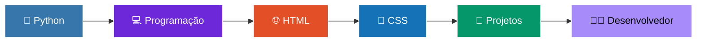

  

---

## 👋 Olá, eu sou o Pietro!

💻 Sou **estudante e desenvolvedor em formação no SENAI**, apaixonado por *tecnologia, programação e desenvolvimento de sistemas*.

Atualmente estou aprimorando meus conhecimentos em **Python, Desenvolvimento Web, Banco de Dados, Back-End e Git/GitHub**, sempre buscando transformar ideias em projetos práticos.

> 🚀 **Aprender → Praticar → Criar → Evoluir**

---

## 🛠️ Tecnologias

| 🐍 Programação | 🌐 Desenvolvimento Web | ⚙️ Ferramentas |
| :---: | :---: | :---: |
|  |  |  |

---

## 📚 O que estou estudando

 

- 🐍 Python
- 🌐 HTML & CSS
- ⚙️ Desenvolvimento Back-End
- 🗄️ Banco de Dados & SQL
- 🔧 Git & GitHub
- 🔐 Segurança da Informação
- 🚀 APIs
- 💻 Desenvolvimento de Sistemas

---

## 💻 Meus projetos

| Projeto | Tecnologias | Descrição |
| :--- | :---: | :--- |
| 🐍 **Sistema Pet Shop** | `Python` | Exercícios e práticas de lógica de programação |
| 🌐 **Sites** *(Linktree, Atividades etc.)* | `HTML` `CSS` | Projetos de desenvolvimento Web |
| ⚽ **Tabela Brasileirão** | `HTML` | Projeto relacionado ao futebol |
| 💻 **Atividades** | `HTML` | Exercícios e projetos acadêmicos |

---

## 📊 GitHub Stats

 

---

## 🔥 Minha jornada

---

## 🎯 Objetivos

- 🚀 Evoluir cada vez mais como desenvolvedor
- 💻 Criar projetos reais e úteis
- 🔐 Aprender mais sobre Cybersecurity
- 🐍 Dominar Python
- 🌐 Desenvolver aplicações Web completas
- 🗄️ Aprofundar meus conhecimentos em Banco de Dados
- 📚 Continuar estudando novas tecnologias

---

## 📫 Conecte-se comigo

---

### 💡 *"Transforme erros em aprendizado, ideias em código e sonhos em projetos."*

 

  

⭐ *Se algum projeto meu te ajudou, considere deixar uma estrela!*

